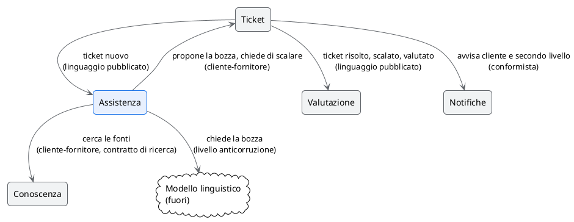

# I contesti e la mappa

## TL;DR

L'help desk di Alpina si divide in cinque contesti: il cuore è l'**Assistenza**, che propone le bozze; il **Ticket** possiede
il ticket e il suo stato; **Conoscenza**, **Valutazione** e **Notifiche** stanno intorno. La regola più importante: lo
stato del ticket lo decide solo il contesto Ticket.

- Cinque contesti: uno di cuore, tre di supporto, uno generico.
- L'Assistenza chiede, il Ticket decide; le metriche ascoltano gli eventi del Ticket.
- Il modello linguistico, fuori, passa da un livello anticorruzione.

## I contesti

| Contesto | Tipo | Scopo | Termini | Possiede e decide |
|---|---|---|---|---|
| Ticket | supporto | tenere i ticket e il loro stato, fino alla risposta al cliente | ticket, stato del ticket, cliente, operatore, secondo livello | lo stato del ticket, l'invio della risposta |
| Assistenza | cuore | proporre una bozza con le fonti, o dire perché no | bozza, fonte, fiducia, soglia di fiducia, assistente | la bozza e la sua fiducia |
| Conoscenza | supporto | dare le fonti per un testo | base di conoscenza, articolo | gli articoli |
| Valutazione | supporto | raccogliere il giudizio degli operatori e misurare | valutazione, primo contatto | le valutazioni, le metriche |
| Notifiche | generico | far arrivare un messaggio a qualcuno | — | niente del dominio |

## La mappa

| Dipendenza | Patto | Perché |
|---|---|---|
| Ticket → Assistenza | linguaggio pubblicato | il Ticket annuncia «ticket nuovo»; non sa chi lo ascolta |
| Assistenza → Ticket | cliente-fornitore | l'Assistenza propone e chiede; lo stato lo cambia il Ticket |
| Assistenza → Conoscenza | cliente-fornitore, con un contratto di ricerca | la ricerca può cambiare (A2: parole e significato) senza toccare l'Assistenza |
| Assistenza → Modello linguistico | livello anticorruzione | il modello è fuori e può cambiare (A1) |
| Ticket → Valutazione | linguaggio pubblicato | le metriche ascoltano gli eventi, non entrano nel ticket |
| Ticket → Notifiche | conformista | le notifiche sono generiche |

## Da decidere

- Il contratto del cliente (ambiguità «cliente» del glossario): se entra, forse è un sesto contesto.
- Quando un ticket è «risolto» (ambiguità del glossario): cambia l'evento che la Valutazione ascolta.
